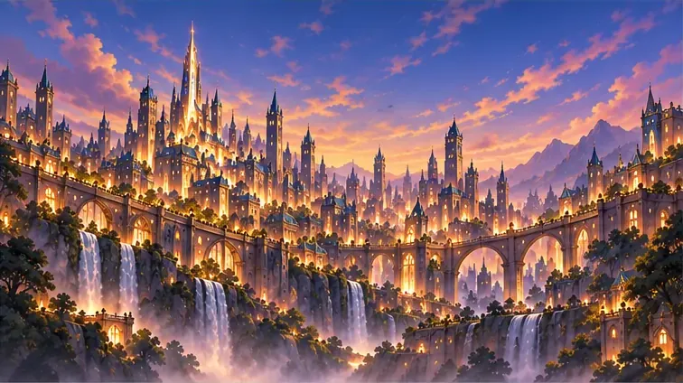
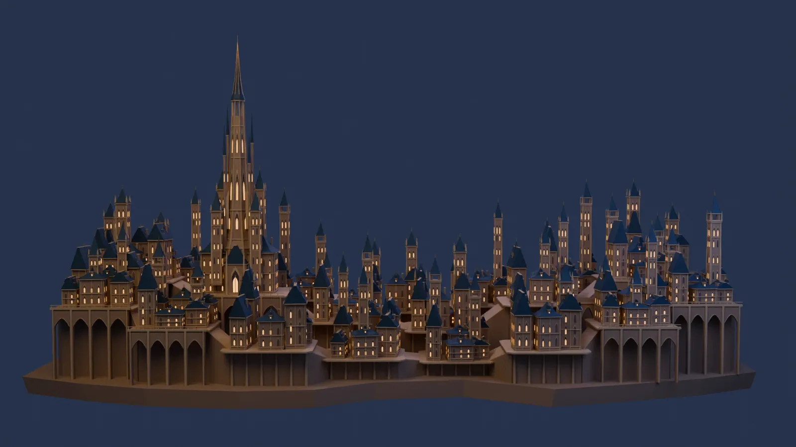
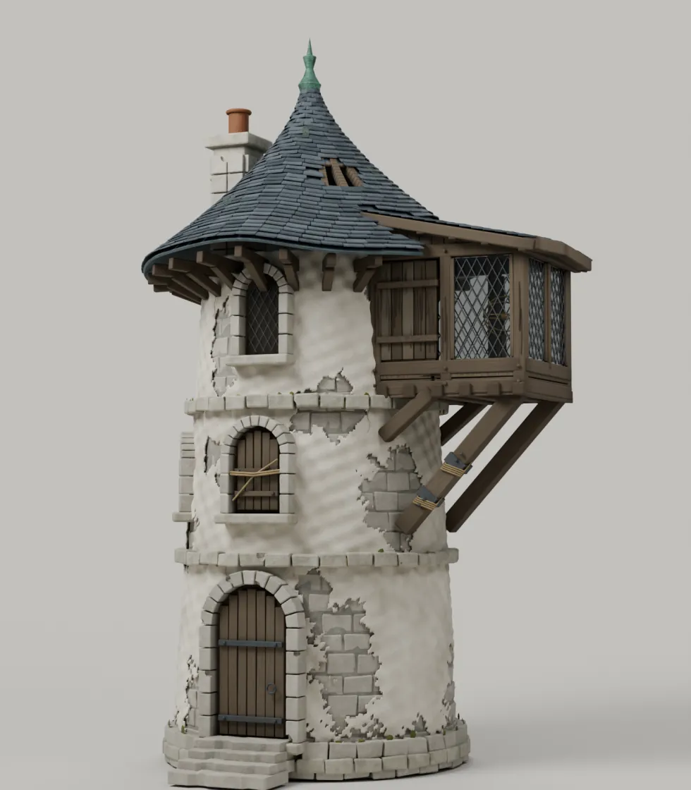
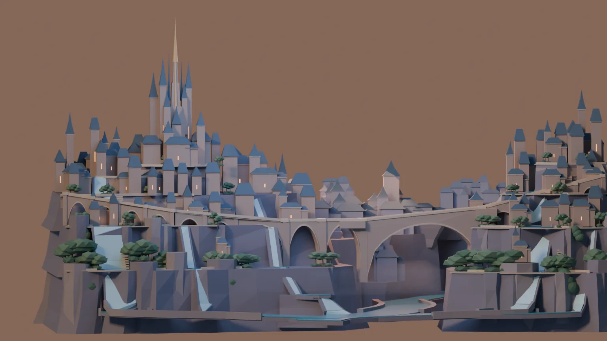
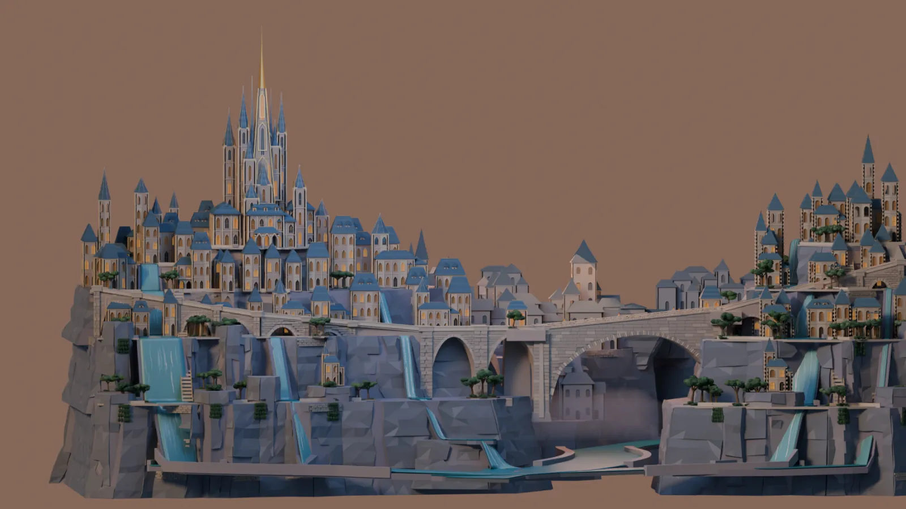

# Building Brightvale Again

One of the reasons I built [Shining Stars](index.md) was to see how far I could push AI at making 3D models. The game worked, but its distant city left that question unresolved. We had concept art with an elaborate golden city, bridges crossing a ravine, waterfalls, vegetation, and towers disappearing into the distance. We had a model that occupied the right part of the screen. Those were not the same achievement.

Over the next couple of days, we went back to that problem. The new city is a substantial improvement. More interesting to me is that we didn't get there by finding a better single prompt. We changed what we asked the agents to build, what we reviewed, and what counted as the finished work.

## The compromise I hadn't agreed to

*The original visual direction: the Audience city panel cropped from the approved generated concept sheet. This is concept art, not a 3D render.*

*The earlier city, in its actual Blender review render. The towers and skyline were there; the ravine landscape, water, and planting were not. Its camera and lighting differ from the rebuilt city's renders below, so this is not a matched before-and-after view.*

Some of the difference between the original city and the concept was understandable. A concept image can suggest details that don't resolve into sensible geometry. A whole city is also a much larger problem than one building.

But that wasn't the whole explanation. Water and foliage had been excluded from the earlier baseline even though they were visible parts of the reference. That decision hadn't been put in front of me as a compromise to approve.

That matters because those elements weren't incidental decoration. They helped make this particular city feel like the place I wanted. Removing them made the job smaller, but it also changed the job.

I don't expect a model to match a concept image pixel for pixel. Concept art is direction, not a contract for every stone. What I do expect is for a significant reduction in scope to be discussed, rather than discovering it when the result doesn't resemble the thing we agreed to make.

My diagnosis was that we'd missed two things: breaking the scene into pieces an agent could actually finish, and keeping the model itself as the goal. Too much of the earlier process had become about writing a script that generated the scene.

## First, try one tower

Before asking for another city, we tried something smaller: a thirty-foot mage's tower that had seen better days. It was complicated enough to need judgment, but contained enough that we could inspect the whole thing.

The agent worked incrementally in Blender, saved the scene, rendered it, inspected the result, and made corrections. Review even caught a regression that needed another pass. The useful loop was not simply generating more geometry. It was looking at what had actually been built and deciding what needed to change.

I rated the earlier modeling work around C+ and this tower A−. That's my assessment, not a benchmark, but the difference was large enough to justify continuing.

There is an important technical distinction here. We did not replace scripts with an AI moving a mouse around Blender. The work still used Python through Blender's background process. What changed was the role of that code. It could make a bounded edit to an existing saved scene instead of having to serve as a complete recipe for regenerating the final model.

The editable Blender file became the thing we were improving. Scripts were a way to work on it.

*The accepted tower experiment, rendered from the saved Blender scene, not a concept image or a game capture.*

## Break up the work, not the world

For the city, we returned to the original concept and agreed on a breakdown before modeling. That included the citadel, the districts on either side, the receding skyline, terraced cliffs and retaining walls, bridges, watercourses and waterfalls, vegetation, and shared lighting direction.

The important part wasn't just having a longer list. These needed to be connected assemblies. A bridge needs to meet its approaches. A district needs a relationship to the ground beneath it. Water and planting need space in the composition, not whatever space happens to remain after the buildings are finished.

We made smaller concept pieces for those parts. Their scope mattered too. The first skyline sheet looked too much like a set of replacement city scenes, so it was rejected and corrected. A reference for subordinate skyline groups should not quietly redesign the whole composition. Likewise, a lighting reference could guide lighting without giving its newly generated architecture authority over the buildings we had already chosen.

That was a more useful way to use generated concept art: give an agent a tractable visual target while keeping the larger scene coherent.

## Approve the shape before detailing it

The next step was a composition map and a complete city blockout. Before spending time on small details, we needed to see whether the major masses, gaps, crossings, and layers worked together.

This was already a vast improvement over the previous attempt. I wanted to keep going, not spend indefinitely trying to force every part of the reference into an exact match. We made a few targeted corrections: improve the read-through under the arches, break up the central roof masses, and give the lower terrain, water, and planting more depth.

*The rebuilt city's blockout in Blender. The connected landscape, crossings, water, and planting were present before detailed architecture.*

Then came detailing. The work proceeded through connected packages, including the citadel, ravine crossing, districts, skyline, and landscape. Each pass started from accepted work rather than treating the entire scene as disposable. Renders gave us something concrete to criticize, and the next edit had a bounded purpose.

This still needed supervision. Remaining contact and approach issues had to be named rather than hidden behind a claim that the scene was finished. The accepted scene also had limits, including stylized static water. I could accept those limits once they were visible. That's different from having them chosen for me without discussion.

The detailed scene was accepted, and the city later went through production preparation and integration into the game. Those were separate steps. Approval of a Blender render did not, by itself, establish that its export would look right or behave well in the browser.

*The accepted detailed city, rendered in Blender from the same reference camera as the blockout. Windows, roofs, masonry, and landscape received further detail. This is the rebuild, not the later texture-baking experiment. The water is stylized and static.*

## What the result cost

This was not a cheap one-shot demonstration. There was a lot of Astra modeling work, multiple concept and review stages, and repeated decisions from me. At the time I described it as expensive, with undeniable quality. I don't have a measured cost comparison that would justify saying this is the cheapest way to build a city, or that spending more caused the improvement.

Several things changed together: scope, decomposition, iteration, and review. We didn't run a controlled experiment that isolated each one. What I can say is that the combined process produced a city I wanted to keep, where the earlier process had produced something I was dissatisfied with.

It also produced too much debris. Intermediate scripts, reports, previews, and evidence directories accumulated until it became difficult to tell what mattered. Moving those files into a specialized tools directory didn't make them useful.

We had to simplify the handoff. Keep the editable source, the production asset and any required textures, and a concise history of important decisions. Keep a tool when it performs a recurring job. Don't preserve every temporary edit script merely because an agent used it once. Git already gives us history; we don't need to promise byte-for-byte regeneration of every artistic decision.

## A better model is not automatically a smaller download

One later experiment deserves to be separated from this success. We tried replacing small geometric details with baked textures. The candidate had fewer triangles, but its compressed export got larger, and other rendering costs increased. Reducing geometry was not enough to establish a useful optimization, particularly when my concern was download size.

We stopped that experiment and did not promote its candidates. That doesn't undo the city rebuild. It means the visual reconstruction succeeded while a subsequent attempt to optimize it didn't go in the direction I wanted.

I think that distinction is important when talking about AI work. It is easy to show an attractive result and let it stand in for every other question: editability, delivery size, runtime behavior, or how much intervention it took. Those questions still need their own answers.

## What I would repeat

I would start with the whole composition, agree on what must remain, and break it into connected pieces. I would approve the blockout before investing heavily in detail. I would have the agent render and inspect its actual work, then make targeted changes to the saved model. And I would make significant compromises explicit before accepting them.

Most of all, I would keep the deliverable clear. We were trying to build Brightvale, not demonstrate that we could write a complicated Blender script.

This experiment gave me a much stronger answer to the modeling question that helped start Shining Stars. With a manageable scope and a real refinement loop, the AI could do substantially better than our first attempt. It still needed direction, criticism, and decisions about when the result was good enough. That is the process I want to keep exploring.
