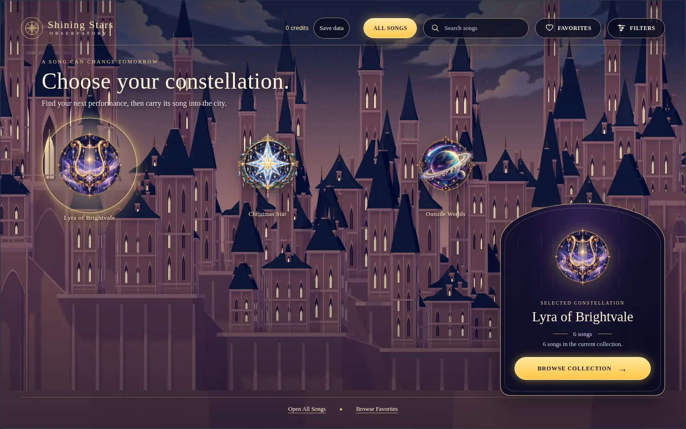
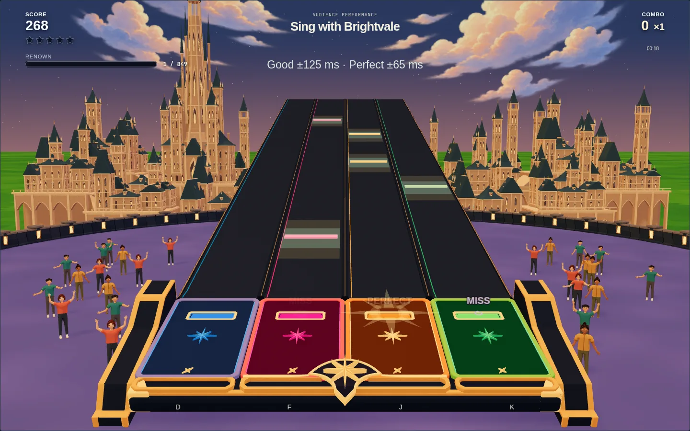
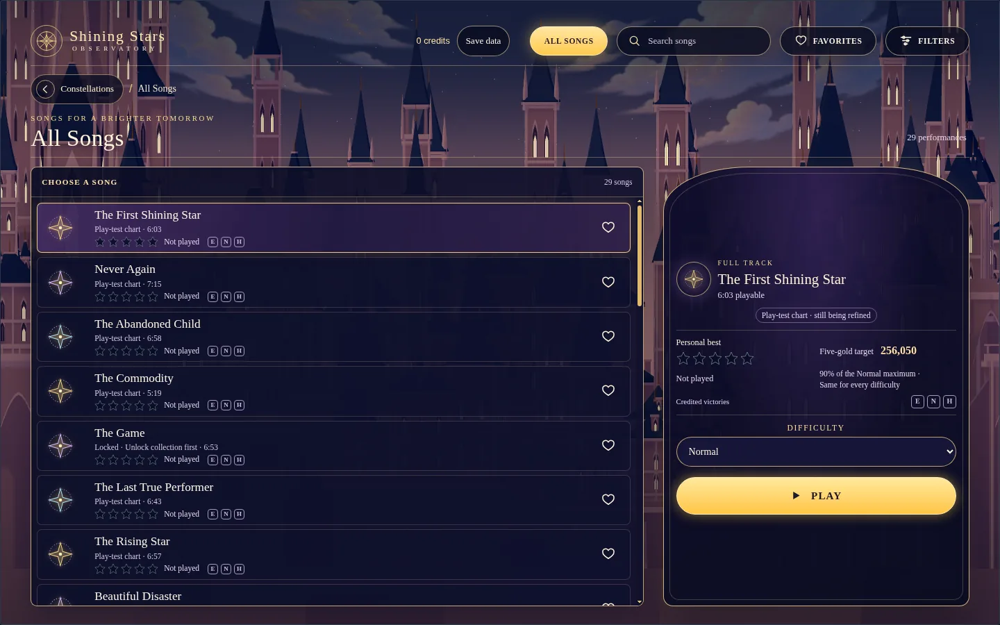

# Shining Stars

Shining Stars is a browser rhythm game about performing music to help save Brightvale from Twilight. It's also an experiment in how far I can push AI beyond writing application code.

I had two particular questions. Could it build useful 3D models, not just attractive concept images? And could it reason through turning songs into rhythm-game charts that actually feel good to play?

Those questions got the project started. Most of the work around them became game design: deciding what a performance means, what the player should notice, and when a technically correct result still isn't the right result.

**Play:** [Shining Stars](https://rjroy.github.io/shining-stars/) | **Source:** [GitHub](https://github.com/rjroy/shining-stars)

*The Observatory brings the three song collections into the city itself.*

## A performance, not just a score

The game has four lanes, played with D, F, J, and K on a keyboard or touch targets on a portrait phone. Notes arrive in time with the music. The catalog contains 29 songs across three collections, with separate Easy, Normal, and Hard charts.

The part that makes it mine is what happens around those notes.

A performance starts with the Audience. Successful hits build Renown. When Twilight arrives, that Renown becomes your Personal Strength, and the performance becomes a confrontation. Successful notes weaken Twilight; mistakes cost you strength. Defeat Twilight and the scene becomes Radiant. The song doesn't stop. You get to finish playing it, and your score and combo keep growing.

*An Audience performance, with the city, crowd, and four-lane highway visible together.*

I didn't want victory to make the rest of the music irrelevant. Scoring and defeating Twilight are separate systems. One measures accuracy and sustained performance. The other gives the song a dramatic arc.

That distinction carries into progression. Five stars fill and then turn gold to show mastery. Twilight victories earn credits toward opening collections and songs. Beating a song on a higher difficulty also credits unbeaten lower difficulties, so taking on Normal first doesn't send you back to Easy to collect a reward you've already surpassed. The starting collection is fully available; the rest of the world opens through play.

The stars say how well you performed. The unlocks say how much of the world you've opened.

## Turning a song into something playable

Finding events in audio is only part of making a rhythm game. You also have to decide which events deserve notes, how dense each difficulty should be, and which lane each note belongs in.

One proposed direction associated lanes with different instruments or frequency bands. That wasn't the experience I wanted. I was more interested in movement that loosely followed pitch: a rising sound should have some relationship to movement across the lanes. But a rigid pitch-to-lane mapping has its own problem. Songs change register and key. A chart with a hundred notes in one lane and two in the others isn't rescued by being faithful to its mapping rule.

We investigated the tradeoffs, including aubio and librosa. The useful question wasn't which library had the more impressive capabilities. It was what signal we could extract, how uncertain that signal was, and how to turn it into playable movement.

The resulting pipeline runs offline. It uses audio onset analysis to find candidate note times and aubio pitch estimates to inform lane placement. Pitch provides a preference, not an instruction. The lane mapper weighs that preference against balance, repetition, and wide jumps. Those controls can be tuned for individual song-and-difficulty pairs rather than forcing the entire catalog through one setting.

This is not melody transcription. A pitch estimate from a complete mix can follow accompaniment or a harmonic instead of the vocal line. We kept that limitation explicit rather than treating a plausible-looking chart as proof that the software understood the song.

The important step was making an experiment playable. We tried the approach on *The Rising Star*, integrated the candidate chart, and I played it. It felt good. That was enough to continue, not enough to declare every song solved. We then made the process reproducible, documented the tuning controls, and extended it to the catalog.

That was one of the more useful parts of working with AI here. It could investigate options, implement an algorithm, and build the tooling around it. But the decision to keep the approach came from playing the result, not from the explanation of why it ought to work.

## From concept art to a game asset

The other experiment was visual. Shining Stars has a deliberately elaborate setting: a golden city, an audience, a performance highway, and the Observatory where you choose songs and collections. I wanted to see whether AI could help carry that direction into actual assets rather than stop at a concept image.

That required separating several kinds of success. An approved image isn't an approved Blender model. A good model isn't necessarily a sensible runtime asset. And an asset that renders well in isolation can still look wrong from the game's camera.

The workflow grew around those distinctions: concept, editable model, production export, then inspection inside the game. Blender scripts made geometry reproducible and gave us something concrete to revise. Export checks and optimization mattered, but they didn't replace looking at the result.

The failures were useful. City inspections exposed disconnected sections, buried windows, and chimney ends that floated above roofs. A crowd-model attempt reached hundreds of thousands of triangles without solving the underlying form. More geometry wasn't the answer. We needed to judge the silhouette and construction before investing further in detail.

A smaller change explained the same problem particularly well. The platform had a gold line across the lanes and bright gold borders around the slots. They looked decorative, but at speed they suggested the wrong place to hit. I marked up a screenshot: remove the line and make the borders mostly their lane colors, with only some gold remaining.

That wasn't a request for a more impressive asset. It was a request for a clearer game. The actual hit location needed to win the player's attention.

## Where the design work lived

Much of the collaboration consisted of corrections like that. Clouds needed to occupy the visible sky rather than sit below the horizon. The city ground needed some green and an organic texture; the audience plaza needed its own surface rather than a flat brown plane. Song details needed to fit beside the song list instead of turning into another scrolling panel.

*Song selection keeps the list and performance details in one view.*

Feedback effects went through the same process. When a star fills or the combo multiplier increases, an enlarged copy expands and fades. The first version was too subtle to notice while playing. We made it much larger and longer, then reduced its opacity and added a dark outline so it didn't read as an opaque duplicate of the interface.

These aren't details an implementation checklist can settle on its own. They depend on where attention goes while someone is trying to hit notes.

The AI did substantial implementation and investigation work. My role was to keep bringing the decisions back to the experience I wanted, play the results, and reject compromises that answered the technical question but missed the design question. Sometimes the smallest change was right. I didn't want it chosen merely because it was fast.

## What the experiment produced

There is now a working game and a repeatable path from source music to playable charts, with a Three.js scene, generated and modeled assets, difficulty tuning, scoring, local records, and save backups. The asset workflow also became useful beyond this project: we extracted reusable skills and moved the game-specific direction into project documents.

There was overhead too. Issue tracking became cluttered enough that we had to reorganize it. Tests and validation caught regressions, but couldn't tell me whether a chart felt musical or a border drew my eye to the wrong place. Producing more artifacts wasn't always progress.

For me, the interesting result isn't that AI can produce a rhythm game from a prompt. It's that it can participate in a much longer loop: investigate something uncertain, build a candidate, accept specific criticism, and revise both the implementation and the process around it.

Shining Stars is still being tuned. The charts aren't all equally proven, and pitch-informed movement isn't the same as understanding the music. But the experiment has reached the point I cared about: I can play it, notice something I want to change, and work with the AI on a concrete improvement. The modeling and music-analysis questions became parts of a game rather than demonstrations sitting beside one.
